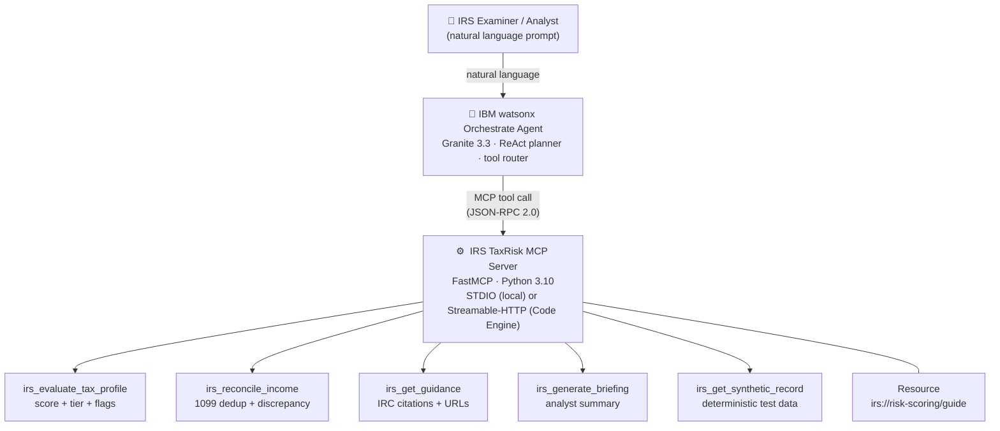

# IRS AI TaxRisk MCP Server

> **⚠ DISCLAIMER — READ FIRST**
> This is a **research prototype** built for the GSA AI/MCP Hackathon.
> All risk scores are produced by a **HYPOTHETICAL** model (engine version `hypothetical-v1`).
> The engine does **not** implement, approximate, or replicate the actual IRS Discriminant
> Index Function (DIF) or any official IRS audit-selection methodology.
> **No legal conclusions may be drawn from any output of this system.**
> All test data is synthetic. No real taxpayer information is used anywhere in this project.

---

## What This Is

An AI-native tax compliance risk analysis server built on the
[Model Context Protocol (MCP)](https://modelcontextprotocol.io/).
It exposes a structured, versioned, type-safe API for scoring taxpayer profiles,
reconciling 1099 income records, and retrieving IRS guidance citations — all designed
to be called by an AI agent running on **IBM watsonx Orchestrate**.

The project demonstrates how MCP can make a black-box risk model explainable and
agent-callable, and how a reproducible evaluation framework can validate the system
before it is shown to judges or users.

---

## Use Case and Objectives

### Problem

IRS examiners process millions of returns annually. Identifying high-risk returns
requires statistical modeling across three primary signals:

| Signal | Trigger | IRC Reference |
|--------|---------|---------------|
| Income Mismatch | Third-party 1099 total > self-reported income | § 6201 |
| Outlier Deductions | Charitable contributions > 20% of gross income (invented statistical threshold — not an IRS-published limit) | § 170 (see note) |
| Business Loss Pattern | 4+ of 5 years show Schedule C/F losses | § 183 (one of nine factors only) |

> **Note on the 20% threshold:** The 20% charitable-to-gross-income ratio used by this model is an
> **invented statistical reference value** chosen for demonstration purposes. It is not an official
> IRS-published threshold or deduction limit. Actual IRC § 170 deduction limits depend on AGI,
> recipient type, property type, and tax year. This indicator flags a statistical anomaly for
> examiner review — it is not a determination of § 170 non-compliance.

Traditional risk models are opaque — examiners receive a score with no explanation.
**MCP solves this** by exposing the engine as a structured, citable, version-controlled API.

### Objectives

1. **Numerical correctness** — Deterministic, version-stamped scores that can be unit-tested
2. **Tool-callable by AI** — Each risk function is an MCP tool with a typed JSON schema
3. **Explainable flags** — Every flag includes a plain-English detail field and IRC citation
4. **Non-determinative** — `is_determinative: false` on every flag, reflecting actual legal doctrine
5. **Reproducible evaluation** — A golden dataset with 53 deterministic assertions, tested 3× each

---

## Architecture



**Transport:** STDIO when running locally inside Bob or Claude Desktop.
Streamable-HTTP when deployed to IBM Code Engine. Same codebase — no changes needed.

---

## MCP Tools

All tools are read-only (`readOnlyHint: true`, `destructiveHint: false`), handle no PII,
and embed `engine_version` in every response.

### `irs_evaluate_tax_profile`

Scores a taxpayer profile using the hypothetical risk engine.

| Input | Type | Description |
|-------|------|-------------|
| `case_id` | `str` | Opaque case reference — no PII |
| `tax_year` | `int` | Calendar year (1990–2030) |
| `gross_income` | `float ≥ 0` | Form 1040 line 9, USD |
| `reported_1099_income` | `float ≥ 0` | Self-reported 1099 income |
| `third_party_1099_total` | `float ≥ 0` | Third-party information return total |
| `charitable_contributions` | `float ≥ 0` | Schedule A charitable deductions |
| `business_loss_years_in_window` | `int 0–10` | Loss years in 5-year window |

**Output:** `risk_score` (0–100), `risk_tier` (Low/Medium/High), `flags[]`, `engine_version`

**Hypothetical weights** (not the IRS DIF):

| Flag | Weight | Trigger |
|------|--------|---------|
| `INCOME_MISMATCH` | 40 pts | `third_party_1099_total > reported_1099_income` |
| `OUTLIER_DEDUCTIONS` | 30 pts | `charitable_contributions / gross_income > 0.20` |
| `BUSINESS_LOSS_PATTERN` | 20 pts | `business_loss_years_in_window >= 4` |

**Tier boundaries:** Low < 40 ≤ Medium < 70 ≤ High

### `irs_reconcile_income`

Reconciles a list of 1099 records against a self-reported total.

- Detects duplicate `record_id`s (first occurrence wins)
- Voids originals superseded by corrected forms (`status: corrected`)
- Flags missing originals referenced by corrected forms
- Returns `reconciled_total`, `discrepancy` (positive = underreport), and per-record annotations

### `irs_get_guidance`

Searches a curated static registry of real IRS publications and IRC sections.

Topics covered: IRC § 183 (hobby loss), IRC § 170 (charitable deductions),
IRC § 6201 (1099 information returns), Schedule C / Pub 334, Pub 556 (audit rights).

Returns an empty `results` list for unknown topics — **never hallucinates a citation.**

### `irs_generate_briefing`

Assembles a preliminary analyst briefing from prior tool outputs (risk score,
reconciliation summary, guidance titles). Output includes `recommended_actions[]`
and a mandatory disclaimer that it is not an official IRS document.

### `irs_get_synthetic_record`

Generates deterministic synthetic taxpayer records from a seed string.
The same seed always produces the same values. Useful for reproducible demos and testing.

Scenarios: `baseline`, `income_mismatch`, `outlier_deductions`, `business_loss_pattern`,
`multi_flag`, `clean`.

---

## MCP Prompts and Resources

| Name | Type | Purpose |
|------|------|---------|
| `audit_intake_interview` | Prompt | Guided multi-turn intake for collecting five profile inputs |
| `explain_risk_score` | Prompt | Ask the agent to explain a score in plain English |
| `irs://risk-scoring/guide` | Resource | Reference guide with flag weights, rules, and tier definitions |

---

## Quick Start

### Prerequisites

- Python ≥ 3.10
- [`uv`](https://docs.astral.sh/uv/) (recommended) or pip

### Install

```bash
git clone <repo-url>
cd irs-ai-risk-server
uv venv --python 3.10
source .venv/bin/activate
uv pip install -e ".[dev]"
```

### Run the MCP server (STDIO mode)

```bash
# Canonical modular server (recommended)
uv run python src/irs_risk/app.py

# Or via the installed entry-point (after uv pip install -e ".[dev]"):
irs-risk-server
```

> **Note:** `server.py` at the repo root is the original single-file hackathon prototype.
> It is kept for reference only. Use `src/irs_risk/app.py` for all new work.

### Connect via Bob

The repository includes a `.bob/mcp.json` configuration. Open the project in Bob and the
server connects automatically via STDIO. After connecting, verify with:
`list the available IRS risk tools` — you should see five tools named `irs_evaluate_tax_profile`,
`irs_reconcile_income`, `irs_get_guidance`, `irs_get_synthetic_record`, and `irs_generate_briefing`.

### Deploy to IBM Code Engine (Streamable-HTTP mode)

```bash
# Set MCP_TRANSPORT=streamable-http in your .env
# See deploy/ibm/ for agent YAML and toolkit registration scripts
```

---

## Project Structure

```
irs-ai-risk-server/
├── server.py                          # Original single-file MCP server (prompts + resource)
├── src/irs_risk/
│   ├── engine.py                      # Hypothetical risk engine (pure functions, versioned)
│   ├── models.py                      # Pydantic v2 input/output models
│   ├── reconcile.py                   # 1099 reconciliation algorithm
│   ├── config.py                      # Settings (transport, engine version, SOI endpoint)
│   └── tools/
│       ├── evaluate_profile.py        # irs_evaluate_tax_profile
│       ├── reconcile_income.py        # irs_reconcile_income
│       ├── get_irs_guidance.py        # irs_get_guidance (with static registry)
│       ├── generate_briefing.py       # irs_generate_briefing
│       └── get_synthetic_record.py    # irs_get_synthetic_record
├── tests/                             # Unit tests for engine, models, reconcile, tools
├── eval/
│   ├── config/eval_config.yaml        # Evaluation configuration
│   ├── datasets/golden_dataset.json   # 14 synthetic test cases, 7 dimensions
│   ├── scripts/
│   │   ├── harness.py                 # Main deterministic evaluation harness
│   │   ├── test_eval_deterministic.py # pytest wrapper (run with EVAL_REPEAT=3)
│   │   ├── judge.py                   # LLM-as-judge (activates on WATSONX_API_KEY)
│   │   └── phoenix_integration.py    # Arize Phoenix stubs (not activated)
│   ├── results/                       # JSON run outputs + failure analysis
│   ├── reports/eval_report_v1.md     # Previous report (internal structure)
│   ├── reports/eval_report_v2.md     # Primary report (GSA template, all actual data)
│   └── reports/eval_report_v2.docx   # DOCX version of eval_report_v2
├── deploy/ibm/
│   ├── mdc_irs_risk_agent.yaml        # watsonx Orchestrate agent definition
│   └── local-mcp-toolkit/            # Toolkit registration for Orchestrate
├── presentation/
│   ├── IRS-TaxRisk-MCP-Hackathon-Deck-v2.pptx  # 9-slide deck (current)
│   ├── IRS-TaxRisk-MCP-Hackathon-Deck.pptx     # Original v1 deck
│   ├── demo_script_5min.md            # 5-minute live demonstration script
│   └── screenshot_capture_guide.md   # Screenshot/log capture checklist
└── pyproject.toml
```

---

## Evaluation Summary

A reproducible evaluation framework was built and executed before the demonstration.

| Metric | Value |
|--------|-------|
| Test cases | 14 synthetic cases, 7 dimensions |
| Tool-level passed | **12 / 12** (TC-01–TC-12) |
| Agent-level | **2 NOT EXECUTED** — TC-13, TC-14 (require live Orchestrate agent) |
| Deterministic assertions | 53 passing (tool-level only) |
| Agent-level assertions | 5 SKIPPED — **not counted as passed** |
| Consistency repeats | 3× per case |
| Consistency result | 100% stable (tool-level) |
| In-process latency p50 | < 0.001 s (direct Python calls — excludes MCP transport and LLM inference) |
| LLM judge | Built, not activated (set `WATSONX_API_KEY`) |
| Condition B baseline | Designed, not executed (requires live agent) |

**Run the evaluation:**

```bash
# Full run with consistency repeats
uv run python eval/scripts/harness.py --repeat 3

# pytest integration
EVAL_REPEAT=3 uv run pytest eval/scripts/test_eval_deterministic.py -v
```

See [`eval/reports/eval_report_v2.md`](eval/reports/eval_report_v2.md) for full methodology,
results, and failure analysis. The companion DOCX
([`eval/reports/eval_report_v2.docx`](eval/reports/eval_report_v2.docx)) follows the
GSA sample evaluation document structure.

---

## Environment Variables

Copy `.env.example` to `.env` and configure:

```env
# Transport: stdio (local) or streamable-http (Code Engine)
MCP_TRANSPORT=stdio
MCP_PORT=8000

# Bump when engine weights/thresholds change
# RISK_ENGINE_VERSION=hypothetical-v1

# IRS SOI public data endpoint (optional, no key required)
# IRS_SOI_BASE_URL=https://data.irs.gov/resource

# LLM judge (optional — activates narrative quality evaluation)
# WATSONX_API_KEY=<your-key>
# WATSONX_PROJECT_ID=<your-project>
```

---

## Design Principles

1. **Pure functions.** The risk engine and reconcile module are pure Python — no I/O, no side effects, fully deterministic.

2. **Versioned outputs.** Every `RiskScoreOutput` embeds `engine_version`. Downstream records remain traceable after weights change.

3. **Non-determinative flags.** `is_determinative: false` on every `RiskFlag` reflects actual legal doctrine: no single indicator establishes a legal conclusion under IRC § 183 nine-factor analysis (Treas. Reg. § 1.183-2(b)).

4. **Graceful empty results.** `irs_get_guidance` returns an empty `results` list for unknown topics. It never hallucinates a citation.

5. **No PII.** `case_id` is an opaque reference. No SSN, EIN, taxpayer name, or address anywhere.

6. **Dual transport.** STDIO for local use (Bob, Claude Desktop). Streamable-HTTP for deployment (IBM Code Engine). Same codebase.

---

## Limitations

- **Not the IRS DIF.** Weights are hypothetical. Do not use scores for any compliance decision.
- **Not production-ready.** No ATO, no FedRAMP boundary, no real taxpayer data handling.
- **Agent-level tests pending.** TC-13 (scope adherence) and TC-14 (prompt injection) require a live agent call to verify end-to-end.
- **Guidance registry is small.** Currently covers five topics. Cryptocurrency, FBAR, K-1, and many others are not in the registry.
- **In-process latency only.** Measured latency (< 1 ms) does not include network transport or LLM inference time.

---

## GSA Hackathon Context

Built for the **GSA AI/MCP Hackathon** as a demonstration of:
- MCP as an AI-callable wrapper for a government risk model
- IBM watsonx Orchestrate as the agent orchestration layer
- Reproducible evaluation methodology for AI-powered government tools
- Responsible AI design (disclaimers, non-determinative flags, no PII)

---

## License

This prototype is for demonstration purposes only.
See repository license file for terms.
